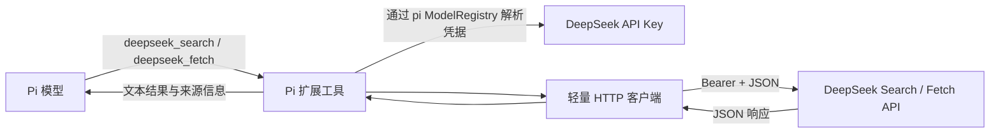

# DeepSeek Search / Fetch pi Package 设计规格

- 日期：2026-10-19
- 状态：设计已确认，尚未实施
- 范围：仅定义架构与行为，不包含实现计划或代码

## 1. 目标

将 DeepSeek Search API 和 Fetch API 封装为 pi package 中两个可由模型直接调用的原生工具。用户使用 pi 已有的 DeepSeek 凭据配置方式；package 不自行读取、存储或管理 API Key。

设计优先保持简单：一个 pi 扩展注册两个工具，一个轻量客户端负责 HTTP 请求和错误解析。不引入 MCP 服务、外部 HTTP 依赖、后台进程、缓存或自动重试。

## 2. 设计决策

采用两个独立的 pi 原生工具：

- `deepseek_search`：调用 DeepSeek Search API，返回网页结果。
- `deepseek_fetch`：调用 DeepSeek Fetch API，返回指定网页的 Markdown 正文。

不采用单个带 `action` 分支的工具，因为两个 API 的输入和输出不同，拆分后工具 schema 更简单，模型也能分别决定搜索和抓取。也不采用 MCP server，因为 pi 扩展可以直接注册 LLM 可调用工具，独立服务会增加运行和配置层。

## 3. 架构



### 3.1 扩展入口

扩展默认导出一个接收 `ExtensionAPI` 的工厂函数，并通过 `pi.registerTool()` 注册两个工具。扩展加载时不启动服务、计时器或其他长期资源。

### 3.2 API 客户端

Search 和 Fetch 共用一个小型请求函数，负责：

1. 通过 pi 的 `ctx.modelRegistry.getApiKeyForProvider("deepseek")` 获取凭据。
2. 对请求设置 `Authorization: Bearer <key>` 和 `Content-Type: application/json`。
3. 使用 Node 原生 `fetch` 发送 POST JSON 请求，并传入工具执行提供的取消信号。
4. 解析 JSON 成功响应和 DeepSeek OpenAI 兼容错误响应。

客户端不直接读取 `process.env`、`auth.json` 或 `models.json`，也不写凭据。凭据解析交由 pi 管理。

### 3.3 数据流

模型选择 `deepseek_search` 或 `deepseek_fetch` 并提交参数。工具执行时从 pi 的 ModelRegistry 解析 DeepSeek provider 凭据；缺少凭据时，返回提示用户使用 pi 的 `/login deepseek` 或 pi 支持的其他 provider 凭据来源。取到凭据后，工具客户端调用对应官方端点，最后将响应整理成适合模型阅读的文本。

## 4. 工具接口

### 4.1 `deepseek_search`

端点：`POST https://api.deepseek.com/v1/tools/search`

| 参数 | 类型 | 必需 | 默认值 | 说明 |
|---|---|---:|---:|---|
| `query` | string | 是 | — | 搜索词，1–128 个 Unicode 字符，不能全为空白；允许 DeepSeek 搜索语法 |
| `count` | integer | 否 | `10` | 返回结果数量，范围 1–50 |
| `ori_question` | string | 否 | — | 引发搜索的原始问题，长度 1–128 个字符 |
| `localization` | string | 否 | — | 可选本地化 IP 地址 |
| `need_content` | boolean | 否 | `false` | 是否要求 Search 结果附带网页正文 |

工具输出逐条呈现标题、URL 和长摘要；若有值，额外呈现短摘要、站点名称、日期、相关度分数和权威等级。`need_content` 为 true 时，包含 API 返回的正文。Search 正常返回空数组时，工具给出清楚的无结果说明，不将其视为异常。

### 4.2 `deepseek_fetch`

端点：`POST https://api.deepseek.com/v1/tools/fetch`

| 参数 | 类型 | 必需 | 说明 |
|---|---|---:|---|
| `url` | string | 是 | 要抓取的 HTTP 或 HTTPS 网页 URL |

输出包含页面标题和 Markdown 正文。API 规定 URL 长度最多 8192 个字符，必须有 host，且不能携带用户名或密码；目标站点可用性和访问策略可能影响抓取结果。

为控制模型上下文占用，Fetch 正文最多输出 30,000 个字符。超过上限时截断正文，并在结果中说明已截断。该上限是实现常量，不提供额外配置接口。

## 5. 认证和配置

- 使用 pi provider ID `deepseek` 调用 `ctx.modelRegistry.getApiKeyForProvider("deepseek")`。
- 不自行从环境变量读取 Key，也不直接读取或修改 `auth.json`。
- 不创建自定义 `/login` 流程。pi 当前内置 DeepSeek provider，用户可以通过 `/login deepseek` 或 pi 支持的其他凭据来源完成配置。
- 如果 pi ModelRegistry 未返回 API Key，工具结果提示用户配置 pi 的 DeepSeek 凭据；提示中不得包含或回显任何 Key。
- API Base URL 固定为 DeepSeek 官方 `https://api.deepseek.com`，第一版不支持代理或自定义 Base URL。

## 6. 错误与取消

- 缺少凭据：提示使用 pi 配置 DeepSeek 凭据。
- HTTP 错误：尽可能解析 DeepSeek 响应中的 `error.message`，并附上 HTTP 状态码。
- 网络错误或非 JSON 响应：返回简明错误信息，不向模型暴露请求头或凭据。
- 用户取消工具调用：将取消结果作为工具错误返回，不继续请求。
- 不自动重试。Search / Fetch 按成功请求计费，自动重试会隐藏额外请求行为；若遇到限流或临时故障，由模型根据错误结果决定是否再次调用。

## 7. Package 布局

```text
package.json
extensions/
  deepseek-web.ts
README.md
```

`package.json` 通过 pi package 的 `pi.extensions` 字段声明扩展入口。扩展使用 pi 提供的 TypeBox 和 Extension API 类型，并使用 Node 原生 `fetch`；不增加运行时网络库。具体 peer dependency 包名和兼容版本应在实施时与目标 pi 版本核对。

## 8. 一级依赖

| 依赖类别 | 包 | 用途 |
|---|---|---|
| 运行时依赖 | 无 | HTTP 使用 Node 原生 `fetch`，无需额外客户端库 |
| peer dependency | `@earendil-works/pi-coding-agent` | pi 扩展 API 类型与宿主契约；由 Pi 提供，不打包 |
| peer dependency | `typebox` | 定义两个工具的参数 schema；由 Pi 提供，不打包 |
| 开发依赖 | `typescript` | 本地静态类型检查；不进入运行时 package |

`typescript` 仅在实施本地类型检查时安装。该仓库目前没有安装它，且安装开发依赖需先获得对 pnpm 默认 store 的审批。不要把 pnpm store 改指临时目录。

## 9. 安全边界与已知风险

当前没有已实现的工具代码或额外运行时依赖，因此尚无可报告的 package 特定漏洞或依赖 CVE。设计层面的已知风险如下：

- **扩展权限**：Pi 扩展在 Pi 进程内执行并拥有该进程的操作系统权限。package 应保持代码范围小，用户只从审阅过的来源安装。
- **网页内容提示注入**：Search / Fetch 返回的网页内容可能包含试图影响模型行为的文字。工具说明和结果应明确将网页内容视为不可信资料；不对内容做复杂过滤。
- **数据与费用**：搜索词和抓取 URL 会发送给 DeepSeek；成功请求可能产生费用。扩展不记录 API Key，也不自动重试。
- **URL 抓取边界**：扩展自身只向固定的 DeepSeek 官方 API 发请求，不在本机直接抓取模型给出的 URL；目标网页由 DeepSeek Fetch 服务端抓取。DeepSeek 文档约束 URL 形式并说明服务会执行安全策略，但目标网站和服务端抓取行为仍应视为外部边界。

第一版不加入域名白名单、复杂内容清洗、确认 UI 或额外权限系统。若将来改为本机直接抓取网页，需重新评估 SSRF 和本机网络访问风险。

## 10. 非目标

第一版不包含：

- MCP server 或单独运行的服务进程。
- 搜索/抓取之外的浏览器控制、页面交互或多轮研究编排。
- LLM 摘要、结果缓存、去重、并发队列或自动重试。
- 自定义登录、凭据存储、API Key 配置 UI 或凭据迁移。
- 可配置的 Base URL、输出上限或额外 provider 适配。

## 11. 验收标准

1. pi 加载 package 后，模型可见并能调用 `deepseek_search` 与 `deepseek_fetch` 两个工具。
2. 两工具都通过 pi ModelRegistry 的 `deepseek` provider 凭据解析获取 API Key。
3. Search 参数映射到官方 Search API，结构化结果和空结果均有可读输出。
4. Fetch 返回标题和 Markdown 正文，且长正文被截断时会明确说明。
5. 缺少凭据、HTTP/API 错误、网络错误和调用取消均返回有用错误，不泄露 Key。
6. package 无需启动额外服务或安装 HTTP 客户端依赖。

## 12. 参考资料

- [Pi Extensions](https://pi.dev/docs/latest/extensions)：扩展生命周期、工具注册及 `ExtensionContext`。
- [Pi Providers](https://pi.dev/docs/latest/providers)：pi 凭据来源、DeepSeek provider 和环境变量配置。
- [Pi Models](https://pi.dev/docs/latest/models)：凭据来源优先级与模型选择。
- [Pi ModelRegistry 实现](https://github.com/earendil-works/pi/blob/main/packages/coding-agent/src/core/model-registry.ts)：扩展侧 provider 凭据解析方法。
- [Pi Packages](https://pi.dev/docs/latest/packages)：package manifest、扩展发现和依赖约定。
- [DeepSeek Search & Fetch](https://api-docs.deepseek.com/zh-cn/guides/search/)：端点、请求字段、响应字段、错误、计费和限流。
